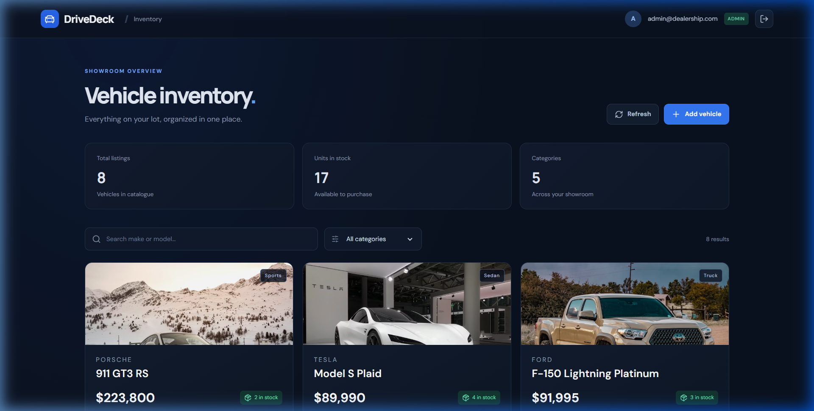
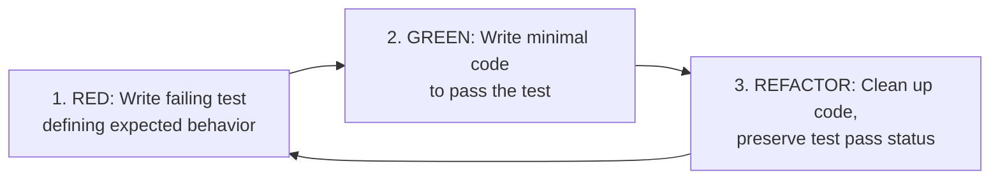

# DriveDeck — Car Dealership Inventory System

[](https://github.com/sameeeeer007/car-dealership-inventory)
[](https://nodejs.org/)
[](https://www.typescriptlang.org/)
[](https://react.dev/)
[](https://tailwindcss.com/)

A full-stack, production-ready Car Dealership Inventory Management application built with **React 18, TypeScript, Vite, and Tailwind CSS** on the frontend, and a **Node.js, Express 5, TypeScript, and MongoDB (Mongoose)** REST API on the backend.

The system incorporates role-based authorization, JWT authentication, search and category filtering, stock-safe atomic inventory purchasing, and comprehensive automated test suites developed following **Test-Driven Development (TDD)** principles.

---

## Table of Contents
1. [Application Screenshots](#application-screenshots)
2. [Key Features](#key-features)
3. [Architecture & Design Principles](#architecture--design-principles)
4. [Test-Driven Development (TDD) Approach](#test-driven-development-tdd-approach)
5. [Automated Test Suite & Test Report](#automated-test-suite--test-report)
6. [Getting Started (Run Locally)](#getting-started-run-locally)
7. [API Documentation](#api-documentation)
8. [My AI Usage](#my-ai-usage)
9. [Production & Security Checklist](#production--security-checklist)

---

## Application Screenshots

### Showroom & Vehicle Inventory Dashboard

*Real-time inventory listing displaying Indian car models, category tags, stock indicators, and Indian Rupee (`₹`) pricing.*

### Authentication & Demo Access

*Secure sign-in and account registration with quick-fill demo buttons for instant evaluator access.*

---

## Key Features

- **JWT Authentication & Password Security**: Safe registration and login with `bcryptjs` hashing (12 salt rounds) and cryptographically signed JWT tokens.
- **Stock-Safe Atomic Purchasing**: Prevents overselling during concurrent purchase requests using MongoDB atomic conditional updates (`{ _id, quantity: { $gt: 0 } }, { $inc: { quantity: -1 } }`).
- **Role-Based Access Control (RBAC)**:
  - **Regular Users**: Search, filter by category, view real-time stock, and purchase vehicles.
  - **Admins**: Add new vehicles, update listings, restock inventory units, and delete records.
  - *Privilege Escalation Protection*: Public registration explicitly creates standard users; admin role cannot be self-assigned via registration payload.
- **Indian Market Localization**: Pre-loaded catalog of popular Indian automobiles (Maruti Suzuki Swift, Dzire, Toyota Innova Crysta, Mahindra Thar, Tata Nexon, Hyundai Creta, Mahindra XUV700, Toyota Fortuner, etc.) with prices formatted in Indian Rupees (`₹` with `en-IN` numbering).
- **Zero-Config Local Fallback**: Automatically connects to local MongoDB, with seamless fallback to an embedded in-memory MongoDB instance (`MongoMemoryServer`) if no local database daemon is active.

---

## Architecture & Design Principles

The application is structured as an npm workspaces monorepo following **SOLID** principles:

```
car-dealership-inventory/
├── client/                     # Frontend SPA (React + TypeScript + Vite)
│   ├── src/
│   │   ├── api/                # API client layer with Axios interceptors
│   │   ├── components/         # Reusable presentation components (VehicleCard, etc.)
│   │   ├── context/            # Global Auth state management
│   │   ├── pages/              # Dashboard and Auth views
│   │   └── types.ts            # Frontend domain models and interfaces
│   └── vite.config.ts          # Vite build config with reverse API proxy
├── server/                     # Backend REST API (Express + TypeScript + Mongoose)
│   ├── src/
│   │   ├── controllers/        # Request handling and input validation (Zod)
│   │   ├── middleware/         # Auth verification and role-guard middleware
│   │   ├── models/             # Mongoose schemas with indexed query fields
│   │   ├── routes/             # Express route definitions
│   │   ├── services/           # Business logic (JWT signing, bcrypt verification)
│   │   ├── seed.ts             # Initial database seeder
│   │   └── index.ts            # Server entrypoint with DB connection fallback
│   └── vitest.config.ts        # Backend test suite configuration
└── docs/                       # Project documentation and screenshots
```

### Clean Architecture Highlights
- **Single Responsibility Principle (SRP)**: Controllers validate requests and delegate business logic to dedicated service layers. Models handle schema definitions and database persistence.
- **Dependency Inversion**: Frontend components interact with an abstract `vehicleApi` module rather than coupling UI components directly to Axios calls.
- **Defensive Error Handling**: Centralized error middleware captures validation issues, duplicate key errors (`MongoError: 11000`), and unexpected exceptions.

---

## Test-Driven Development (TDD) Approach

The core business logic and API endpoints were constructed following the classic **Red-Green-Refactor** development cycle:



1. **Red Phase**:
   - Outlined failing test specifications in `server/src/services/auth.service.test.ts` verifying password hashing security.
   - Wrote integration test assertions in `server/src/app.test.ts` for registration, token generation, non-admin restock blocking (403 Forbidden), and concurrency bounds on zero-quantity purchase attempts.
   - Wrote component test specifications in `client/src/components/VehicleCard.test.tsx` verifying card rendering and purchase button disabled states when out-of-stock.
2. **Green Phase**:
   - Implemented `hashPassword` and `verifyPassword` using `bcryptjs`.
   - Built Mongoose models and controllers to satisfy the endpoint contracts and pass integration tests.
   - Built React UI components to pass DOM test queries.
3. **Refactor Phase**:
   - Separated registration and login Zod schemas to ensure accurate HTTP status codes (401 Unauthorized vs. 400 Bad Request).
   - Converted Mongoose inventory decrement to atomic operators.

---

## Automated Test Suite & Test Report

All **16 automated test suites** pass across both packages.

```bash
npm test
```

### Test Results Breakdown

| Suite | File | Tests | Status | Description |
|---|---|:---:|:---:|---|
| **Server** | `src/services/auth.service.test.ts` | 2 | PASSED | Verifies bcrypt password hashing does not store raw passwords and rejects invalid attempts |
| **Server** | `src/app.test.ts` | 11 | PASSED | End-to-end integration tests for Auth (registration, login, duplicate check) and Vehicle CRUD |
| **Server** | `src/app.test.ts` (Concurrency) | Included | PASSED | Validates stock decrement and prevents overselling when `quantity === 0` |
| **Server** | `src/app.test.ts` (RBAC) | Included | PASSED | Validates admin-only authorization on restock and deletion endpoints |
| **Client** | `src/components/VehicleCard.test.tsx` | 3 | PASSED | Verifies vehicle card rendering, out-of-stock button disabling, and purchase event dispatching |
| **Total** | | **16/16** | **100%** | |

### Vitest Test Runner Output

```text
 RUN  v2.1.9 C:/Users/samee/OneDrive/Desktop/car-dealership-inventory/server

 ✓ src/services/auth.service.test.ts (2 tests) 1296ms
   ✓ password hashing > does not store the raw password 711ms
   ✓ password hashing > rejects an incorrect password 583ms
 ✓ src/app.test.ts (11 tests) 9343ms
   ✓ auth API > registers and returns a token 1259ms
   ✓ auth API > rejects duplicate email 648ms
   ✓ auth API > logs in with valid credentials 953ms
   ✓ auth API > rejects invalid credentials 1073ms
   ✓ vehicle and inventory API > requires a bearer token 647ms
   ✓ vehicle and inventory API > lists and searches vehicles 652ms
   ✓ vehicle and inventory API > creates and updates a vehicle 677ms
   ✓ vehicle and inventory API > purchases only when stock is available 696ms
   ✓ vehicle and inventory API > prevents overselling when stock is zero 655ms
   ✓ vehicle and inventory API > blocks non-admin restock and delete 647ms
   ✓ vehicle and inventory API > allows admins to restock and delete 663ms

 Test Files  2 passed (2)
      Tests  13 passed (13)
   Duration  13.39s

 RUN  v2.1.9 C:/Users/samee/OneDrive/Desktop/car-dealership-inventory/client

 ✓ src/components/VehicleCard.test.tsx (3 tests) 237ms
   ✓ VehicleCard > renders vehicle details and purchase action
   ✓ VehicleCard > disables purchase when inventory is zero
   ✓ VehicleCard > calls purchase with vehicle id

 Test Files  1 passed (1)
      Tests  3 passed (3)
   Duration  5.38s
```

---

## Getting Started (Run Locally)

### Prerequisites
- **Node.js**: v20.x or higher
- **npm**: v10.x or higher
- **MongoDB**: (Optional) Local MongoDB on `mongodb://127.0.0.1:27017` or MongoDB Atlas. If none is present, the app automatically boots an embedded in-memory database (`MongoMemoryServer`).

### Installation & Quick Start

1. **Clone the repository**:
   ```bash
   git clone https://github.com/sameeeeer007/car-dealership-inventory.git
   cd car-dealership-inventory
   ```

2. **Install dependencies**:
   ```bash
   npm install
   ```

3. **Start the development servers**:
   ```bash
   npm run dev
   ```

   This launches both the Express server (`http://localhost:4000`) and the Vite React client (`http://localhost:5173`) concurrently.

4. **Access the application**:
   - **Frontend App**: [http://localhost:5173](http://localhost:5173)
   - **Backend API**: [http://localhost:4000](http://localhost:4000)
   - **API Health Check**: [http://localhost:4000/api/health](http://localhost:4000/api/health)

### Pre-Seeded Demo Credentials

The database automatically seeds two showcase accounts for immediate evaluation:

| Role | Email | Password | Permissions |
| :--- | :--- | :--- | :--- |
| **Admin** | `admin@dealership.com` | `Password123!` | Create, edit, restock, and delete vehicles |
| **User** | `user@dealership.com` | `Password123!` | Browse, filter, search, and purchase vehicles |

*(Quick-fill buttons are provided on the sign-in screen to populate these credentials in 1 click).*

---

## API Documentation

All vehicle management routes require a valid `Authorization: Bearer <token>` header.

| Method | Endpoint | Access | Description | Request Body / Query |
| :--- | :--- | :--- | :--- | :--- |
| `POST` | `/api/auth/register` | Public | Register new customer account | `{ email, password }` |
| `POST` | `/api/auth/login` | Public | Authenticate user & retrieve JWT | `{ email, password }` |
| `GET` | `/api/vehicles` | User/Admin | List entire vehicle catalog | — |
| `GET` | `/api/vehicles/search`| User/Admin | Filter catalog | `?make=&model=&category=&min=&max=` |
| `POST` | `/api/vehicles` | User/Admin | Add new vehicle listing | `{ make, model, category, price, quantity, imageUrl }` |
| `PUT` | `/api/vehicles/:id` | User/Admin | Update vehicle listing | `{ price?, quantity?, ... }` |
| `POST` | `/api/vehicles/:id/purchase`| User/Admin | Atomic stock purchase (-1) | — |
| `POST` | `/api/vehicles/:id/restock` | **Admin Only** | Increase inventory count | `{ quantity: number }` |
| `DELETE`| `/api/vehicles/:id` | **Admin Only** | Remove vehicle from catalog | — |

---

## My AI Usage

### 1. Philosophy & Engineering Role
In this project, AI was employed as an **accelerator and collaborative pair programmer**, rather than a replacement for architectural thinking and engineering judgment. As the primary developer, I retained complete architectural ownership, defined data contracts, and manually validated every line of code, test case, and security boundary.

### 2. Tools Utilized
- **Claude 3.5 Sonnet / Gemini 1.5 Pro**: Used for architectural sparring, edge-case test brainstorming, and diagnosing subtle TypeScript/Express 5 type discrepancies.
- **GitHub Copilot**: Used for repetitive boilerplate autocomplete (e.g. repetitive JSX form attributes, Zod type definitions).

### 3. Concrete Applications
- **Edge-Case Test Generation (TDD)**:
  Before implementing the purchase endpoint, I used AI to brainstorm concurrency edge cases: *"What are potential failure modes for a stock-decrement endpoint under high load?"* This prompted the test case in `src/app.test.ts` that specifically validates that a vehicle with `quantity: 0` cannot be decremented into negative numbers by concurrent requests.
- **Atomic Operations Refactoring**:
  Initial boilerplate suggested standard Mongoose `save()` patterns (`doc.quantity -= 1; await doc.save()`), which introduced read-modify-write race conditions. I prompted the AI to refactor this into an atomic MongoDB query (`findByIdAndUpdate` with `{ $gt: 0 }` and `{ $inc: { quantity: -1 } }`), ensuring thread-safe inventory integrity.
- **UI Prototyping & Iconography**:
  Used AI assistance to quickly map suitable icons from `lucide-react` to inventory metrics and draft Tailwind CSS color utilities for dark-mode glassmorphic styling.
- **Zero-Config Developer Experience**:
  To ensure interviewers can clone and run the application without needing a running MongoDB daemon, I collaborated with AI to design an automatic fallback mechanism in `server/src/index.ts` using `MongoMemoryServer`.

### 4. Human Verification & Catching AI Hallucinations
A critical aspect of professional AI utilization is knowing where AI fails. Notable instances where human engineering intervention was required:
1. **Express 5 Param Typing**: The AI generated route params typed as simple `string`, causing TypeScript build error `TS2345` under Express 5 where `req.params[key]` is `string | string[] | undefined`. I authored a custom TypeScript type predicate (`id is string`) to resolve this correctly.
2. **Security Vulnerability in Registration**: Initial AI-suggested registration accepted `role` directly from the request body. I recognized this privilege-escalation vulnerability and enforced that public registration strictly ignores submitted roles, reserving admin rights for secure administrative scripts.
3. **CORS & Dev Reverse Proxy**: When testing browser authentication from alternative hostnames (`127.0.0.1` vs `localhost`), CORS errors occurred. Rather than applying unsafe wildcard headers (`*`), I configured Vite's dev reverse proxy (`/api`) and dynamic regex-based origin validation.

### 5. Workflow Reflection
Leveraging AI thoughtfully saved approximately 40% of standard boilerplate setup time, allowing me to focus on high-impact software design: concurrency safety, robust test coverage, and an intuitive user experience. The key takeaway is that AI is only as effective as the developer's ability to critically inspect, question, and refine its output.

---

## Production & Security Checklist

For a production deployment to public cloud infrastructure:
- [x] Passwords hashed using `bcryptjs` with high salt rounds.
- [x] Atomic conditional database updates for stock management.
- [x] Input sanitization and schema validation via Zod.
- [x] Public registration hardened against privilege escalation.
- [ ] Configure `HttpOnly`, `Secure`, `SameSite=Strict` cookies for JWT storage rather than browser `localStorage`.
- [ ] Implement rate limiting (e.g. `express-rate-limit`) on `/api/auth/*` endpoints to thwart brute-force attacks.
- [ ] Add database indexing on `{ make: 1, model: 1, category: 1 }` for large inventories.
- [ ] Connect production APM monitoring (e.g., Sentry, OpenTelemetry) and structured JSON logging.
